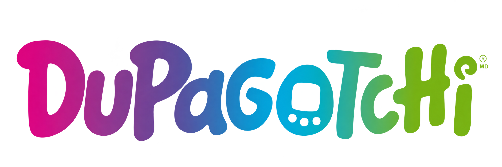

<h1></h1>

A Tamagotchi dupe for desktop. Drag it anywhere on your desktop and care for your pet using the three buttons.


Use A / B / C to play. Right-click for sound, pause, and save controls. Progress saves automatically.

Bring your own supported Tamagotchi P1 ROM and import it with **Choose ROM**. ROMs are not included.

## Requirements

Node.js **22.12+**, npm, and a C compiler:

- **macOS:** `xcode-select --install`
- **Windows:** Install [MSYS2](https://www.msys2.org/), run `pacman -S --needed mingw-w64-ucrt-x86_64-gcc` in its UCRT64 terminal, and add `C:\msys64\ucrt64\bin` to your Windows `PATH`. Use PowerShell or Command Prompt for npm commands.
- **Ubuntu 24.04:** `sudo apt install build-essential libgtk-3-0 libnss3 libgbm1 libasound2t64` (older Ubuntu: use `libasound2`). Other Linux distributions need equivalent packages and a graphical desktop.

## Run

```sh
git clone https://github.com/shirin-manzari/dupagotchi.git
cd dupagotchi
npm ci
npm start
```

## Build an app

Run `npm run package` on your target OS and CPU architecture. Find the app in `release/`: `.app` on macOS, `DuPaGotchi.exe` on Windows, or `DuPaGotchi` on Linux. Keep the full output folder on Windows/Linux.

## License

[GPLv2](LICENSE). Emulation powered by [TamaLIB](https://github.com/jcrona/tamalib).
