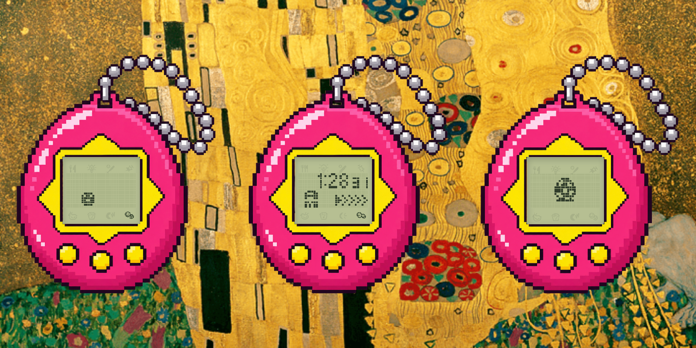

<h1></h1>

A Tamagotchi dupe for desktop. Drag it anywhere on your desktop and care for your pet using the three buttons.



- Use A / B / C to play.
- Right-click for sound, pause, and save controls.
- Your progress saves automatically.

The ROM is not included due to copyright. Click **Choose ROM** to import your own Tamagotchi P1 ROM. [🌚]

## Requirements

For building and running from source:

- macOS, Windows, or desktop Linux.
- Node.js 22.12.0 or newer, with npm.
- A C compiler for your OS:
  - macOS: Xcode Command Line Tools (`xcode-select --install`).
  - Windows: [MSYS2](https://www.msys2.org/) with UCRT64 GCC. In the MSYS2 UCRT64 terminal, run `pacman -S --needed mingw-w64-ucrt-x86_64-gcc`, then add `C:\msys64\ucrt64\bin` to your Windows `PATH`. Run the npm commands below in PowerShell or Command Prompt. MSVC is not supported by the build script.
  - Ubuntu 24.04: `sudo apt install build-essential libgtk-3-0 libnss3 libgbm1 libasound2t64`. Older Ubuntu releases use `libasound2` instead of `libasound2t64`. Other distributions need the equivalent compiler and Electron runtime libraries.
- A supported Tamagotchi P1 ROM, imported with **Choose ROM** on first launch.

Packaged apps do not need Node.js, npm, or a compiler. Linux still needs the desktop libraries listed above. All versions need a supported ROM. Linux requires a graphical desktop; transparency and window behavior may vary by window manager.

## Run

```sh
npm install
npm start
```

## Install

Build the app from source:

```sh
npm install
npm run package
```

Build on the OS and CPU architecture you want to distribute to; the native emulator is built for the current machine. Find the output in `release/`:

- macOS: move `DuPaGotchi.app` to Applications.
- Windows: keep the whole output folder together and run `DuPaGotchi.exe`.
- Linux: keep the whole output folder together and run `./DuPaGotchi` from it.

Use ZIP for Windows/macOS or tar.gz for Linux when sharing the output folder. These are portable app bundles, not installers.

## Checks and automated builds

Run `npm test` to check native commands and save/restore using synthetic ROM data, and `npm run smoke` to check that the desktop interface opens without a ROM. The smoke test needs a graphical session (or `xvfb-run -a npm run smoke` on Linux).

GitHub Actions builds, tests, and packages the app separately on macOS, Ubuntu, and Windows. Download the platform archives from a successful run's artifacts.

## License

Lcensed under the [GNU General Public License v2.0](LICENSE).

The emulation core uses [TamaLIB](https://github.com/jcrona/tamalib).
